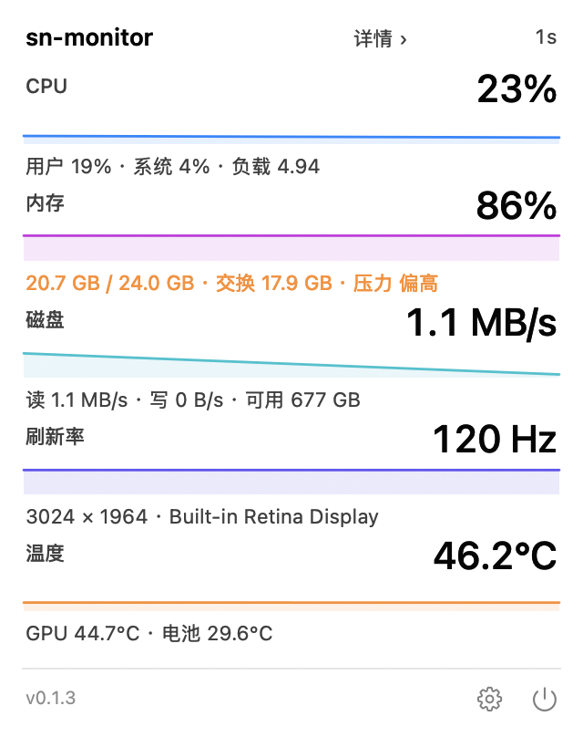
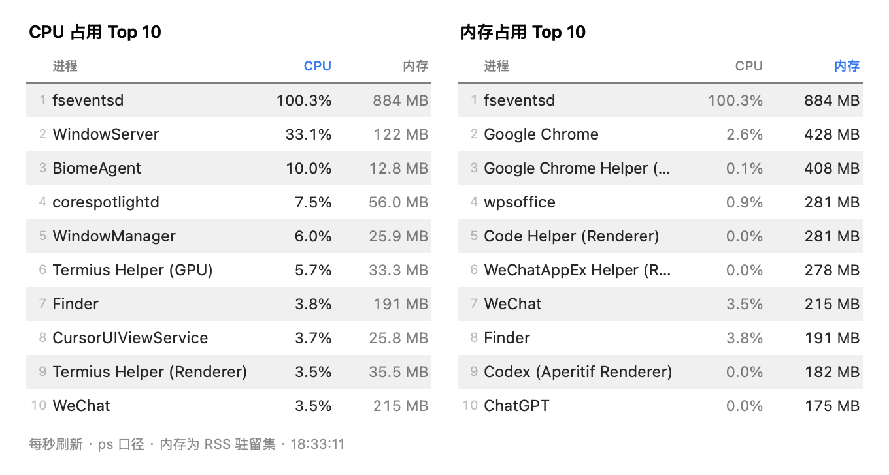

# sn-monitor

[](https://github.com/XinCm/sn-monitor/actions/workflows/ci.yml)
[](LICENSE)


轻量的 macOS 菜单栏系统监视器：**CPU、内存、磁盘、刷新率、温度**。原生 Swift 实现，无第三方依赖。



## 特性

- **菜单栏常驻**：默认显示 `21% 86%`（CPU / 内存），值不变不重绘
- **实时面板**：五项指标 + 最近 2 分钟迷你折线
- **1 秒采样**：可调 0.5 / 1 / 2 / 5 秒；温度每 2 秒刷新一次
- **轻量**：常驻 footprint 约 11 MB，CPU 约 0.3% 单核
- **菜单栏空间兜底**：图标被刘海遮住时自动启用 Dock 图标，`⌃⌥M` 可随时开关面板
- **可配置菜单栏**：CPU + 内存 / CPU + 内存 + 温度 / CPU + 温度 / 仅 CPU / 仅图标
- **进程详情**：点击面板顶部「详情 ›」查看 CPU / 内存占用前十的进程，每秒刷新
- **CLI**：`snctl` 支持 JSON 与文本输出，方便脚本化
- 无网络请求、无后台守护进程、无第三方依赖

## 环境要求

- macOS 13 或更新版本
- Swift 6+：Xcode 16+，或 Command Line Tools（含 Swift Testing）
- Apple silicon 已实测；Intel 机器可编译，但温度传感器未实机验证

## 构建与运行

```bash
git clone git@github.com:XinCm/sn-monitor.git
cd sn-monitor

make build
open dist/sn-monitor.app
```

`make build` 会执行 release 构建、组装 `.app`、复制 Info.plist 与图标，并做 ad-hoc 签名。

也可以只用 SwiftPM：

```bash
swift build -c release
make test            # 自动兼容仅安装 Command Line Tools 的环境
```

如果使用完整 Xcode 16+，也可以直接 `swift test`。

安装到「应用程序」：

```bash
cp -R dist/sn-monitor.app /Applications/
open /Applications/sn-monitor.app
```

## 使用

- **左键点击**菜单栏文字打开面板；**右键**或面板右下角齿轮打开设置
- **⌃⌥M** 随时打开/关闭面板
- 菜单栏显示内容、刷新间隔、Dock 图标、开机启动都可以在设置里改
- 开机启动使用 `SMAppService`，建议先把 app 放进 `/Applications`

### 进程详情



点击面板顶部的 **详情 ›** 打开进程详情窗口：

- 左列：CPU 占用 Top 10（% 单核，多线程可超过 100%）
- 右列：内存占用 Top 10（RSS 驻留集）
- 每秒刷新，关闭窗口即停止采样
- 数据来自 `/bin/ps`，因此包含 root 系统进程；排序和 `ps` 基本一致

详情窗口会遍历系统进程（约 600 个可读进程），打开期间 CPU 约增加 1–1.5% 单核；关闭后回到常驻水平。

### 菜单栏图标不见时

macOS 菜单栏空间不足时，多出来的图标会被放到刘海下面并隐藏（进程仍在运行）。App 会检测这种情况：

1. 自动启用 Dock 图标（可在设置中关闭）
2. 面板底部显示「菜单栏已满 · ⌃⌥M」
3. 随时按 `⌃⌥M` 打开面板

想恢复菜单栏显示，可以移除一些菜单栏项目，或把「菜单栏显示」改成「仅图标」。

## 指标与口径

| 指标 | 数据源 | 说明 |
| --- | --- | --- |
| CPU | `host_statistics(HOST_CPU_LOAD_INFO)` | tick 差值；user(+nice) / system / idle；另显示 1 分钟负载 |
| 内存 | `host_statistics64(HOST_VM_INFO64)` | App(anonymous - purgeable) + wired + compressed；含 swap 与内存压力 |
| 进程 Top 10 | `/bin/ps -Ao pid,pcpu,rss,comm` | 含 root 系统进程（fseventsd / WindowServer 等）；CPU 为 ps 口径，内存为 RSS；仅详情窗口打开时采样 |
| 磁盘容量 | `URLResourceValues.volumeAvailableCapacity` | 与 Finder / `df -H` 一致；30 秒缓存 |
| 磁盘吞吐 | `IOBlockStorageDriver.Statistics` | 只统计整块物理盘，过滤磁盘镜像和 APFS 虚拟盘 |
| 刷新率 | `CGDisplayCopyDisplayMode` | 主显示器名义刷新率（如 120Hz） |
| 温度 | AppleSMC（私有 IOKit API） | 启动时探测传感器 key；CPU 取 4 个代表值、GPU 2 个、电池 1 个；2 秒刷新 |

单位约定：内存用二进制（24.0 GB = 24 GiB），磁盘用十进制（685 GB），与 Finder 一致。

## 资源占用

在 Apple M5 / macOS 26 上实测（1 秒采样）：

| 状态 | Memory footprint | CPU（单核占比） |
| --- | --- | --- |
| 面板关闭（仅菜单栏） | 11.1–11.5 MB | 0.25–0.34% |
| 面板打开（1 秒更新） | 23–26 MB | 0.55–0.80% |
| 详情窗口打开 | 约 38 MB 起（重绘瞬间更高） | 约 1.3–1.7% |
| 单次采样 | — | 0.6–3 ms |

RSS 会显示 40MB+（包含共享库映射），判断轻重应看 footprint。菜单栏文字重绘是主要 CPU 来源；图标被遮挡时会跳过重绘。

## 命令行

```bash
# 单次 JSON 快照（开发时）
swift run snctl --json

# 持续输出文本，1 秒一次
swift run snctl --text --watch --interval 1

# 构建后直接运行
.build/release/snctl --json
.build/release/snctl --text --watch --count 5
```

`snctl` 与 App 复用同一套 `SNMonitorCore` 采样代码，数值口径一致。

## 项目结构

```
.
├── Package.swift
├── Sources/
│   ├── SNMonitorCore/      # 采样库（CPU / 内存 / 磁盘 / 显示 / SMC / 进程 / 引擎）
│   ├── SNMonitorApp/      # AppKit 菜单栏、面板与进程详情窗口
│   └── snctl/              # CLI
├── Tests/SNMonitorCoreTests/
├── Resources/              # Info.plist、AppIcon.icns
├── scripts/
│   ├── package-app.sh      # 组装 dist/sn-monitor.app
│   └── sn-monitor          # 打开 app 的启动脚本
├── docs/
│   ├── DESIGN.md           # 设计说明
│   ├── panel.png
│   └── processes.png
└── .github/workflows/ci.yml
```

## 开发

```bash
make test           # 单元测试（CLT 环境会自动补 Swift Testing 框架路径）
swift build         # 编译
make build          # 打包 .app
```

调试环境变量：

```bash
SNM_STATS=1     .build/release/sn-monitor               # 每 5 秒打印 footprint / CPU / 分项耗时
SNM_SHOW_PANEL=1 .build/release/sn-monitor              # 启动后自动打开面板
SNM_SNAPSHOT=/tmp/panel.png .build/release/sn-monitor   # 把面板渲染成 PNG
```

更多实现细节见 [docs/DESIGN.md](docs/DESIGN.md)。

## 已知限制

- 温度依赖 AppleSMC 私有 API，**不能上架 Mac App Store**
- 温度取代表性传感器最大值，不是每核精确读数，且每 2 秒更新一次
- 刷新率是显示器名义值，不反映 ProMotion 动态帧率
- 磁盘吞吐只统计整块物理盘，外接盘/磁盘镜像不计
- 进程详情的 CPU 列是 `ps` 的近期平均值（非严格 1 秒差值），内存列是 RSS，均与活动监视器口径略有差异
- 菜单栏放不下时图标会被 macOS 隐藏，需要 Dock 图标或 `⌃⌥M` 兜底

## License

[MIT](LICENSE)
